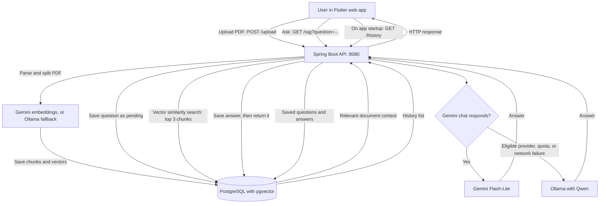
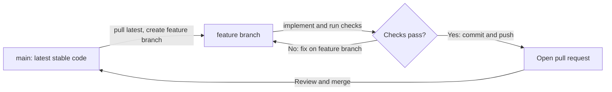

# Document RAG Assistant

A PDF question-answering project with a Flutter web interface, a Java/Spring Boot API, and PostgreSQL with pgvector. The backend and database run in Docker. The Flutter development server runs on your computer.

## Project execution flow



The frontend uses HTTP calls to the backend; AI models run in the backend. PostgreSQL keeps document vectors and question history in the Docker named volume.

## What you need

- [Git](https://git-scm.com/downloads)
- [Docker Desktop](https://www.docker.com/products/docker-desktop/) with Docker Compose; start Docker Desktop before running commands
- A [Google AI Studio](https://aistudio.google.com/) Gemini API key, or [Ollama](https://ollama.com/download) running on your computer with the models below
- [Flutter SDK](https://docs.flutter.dev/get-started/install) only if you want to run the web UI; the backend-only API can run without Flutter

Java, Maven, and PostgreSQL do not need to be installed on your computer when you use Docker Compose. The Dockerfile builds the Java service with Maven inside a build container.

## Clone the project

The backend is included in this repository at `document-rag/document-rag`; it is not a separate Git submodule.

```bash
git clone https://github.com/Chandrasekhar-maker/RAG_System.git
cd RAG_System
```

## Configure AI access

Copy the example environment file at the repository root:

```powershell
# Windows PowerShell
Copy-Item .env.example .env
```

```bash
# macOS / Linux
cp .env.example .env
```

Edit `.env` and set a strong `DB_PASSWORD`. For cloud generation, set `GEMINI_API_KEY` to a key from Google AI Studio. The default chat model is `gemini-3.5-flash-lite`; change `GEMINI_CHAT_MODEL` to select another available model. The default output cap is 512 tokens (`GEMINI_MAX_OUTPUT_TOKENS` / `OLLAMA_NUM_PREDICT`).

For local Ollama fallback, install Ollama on the host and download the configured models:

```bash
ollama pull qwen2.5:3b-instruct
ollama pull nomic-embed-text
```

The default `OLLAMA_BASE_URL=http://host.docker.internal:11434` lets the backend container reach Ollama on the host. Ollama is optional when Gemini is configured and reachable. Never commit your `.env` or publish your API key.

## Run the backend and database with Docker

Run these commands from the repository root (the folder containing this README and the root `docker-compose.yml`):

```bash
docker compose up --build -d
docker compose ps
docker compose logs -f app
```

The first command builds the Spring Boot image and starts the API and pgvector database. The API is published at `http://localhost:8080`. Press Ctrl+C to stop following logs; containers keep running.

The Compose stack does not run Flutter. To use the UI, install Flutter, open another terminal, then run:

```powershell
cd rag_frontend
flutter pub get
flutter run -d web-server --web-port 8081
```

Open `http://localhost:8081`. The frontend calls the API at `http://localhost:8080`. Keep the Flutter command running while using the page. For API-only use, skip these Flutter steps.

## Try the API

Upload a PDF (PowerShell or a terminal with `curl`):

```bash
curl -X POST http://localhost:8080/upload -F "file=@/path/to/document.pdf"
```

Ask a question after uploading a document:

```text
http://localhost:8080/rag?question=What%20are%20the%20main%20points%3F
```

The Flutter app loads the saved question/answer history from `GET /history` when it starts. Each new question and its answer are stored in PostgreSQL, so they remain available after restarting the API or database container as long as you keep the Docker volume. Questions asked before history was added are not recoverable. `docker compose down -v` deletes this history together with the database volume.

The first request may take longer while an AI provider responds. By default, the app uses Gemini Flash-Lite, caps output at 512 tokens, disables the optional second polishing call, and limits provider retries with short backoff before trying Ollama. These settings reduce avoidable work and fallback delays, but cannot control the provider's own response time. Set `APP_RAG_REFINER_ENABLED=true` in `.env` to enable answer polishing, then recreate the backend with `docker compose up -d --force-recreate app`.

## Work with branches and contribute

Start from the current main branch and create a branch for each task:

```bash
git switch main
git pull origin main
git switch -c feature/describe-your-change
```



Make your changes, run the relevant checks, and rebuild the backend if you changed backend code:

```bash
docker compose up --build -d
```

For backend tests, Java 21 is required if running them on the host:

```powershell
cd document-rag\document-rag
.\mvnw.cmd test
```

On macOS/Linux, use `./mvnw test`. Flutter checks require Flutter SDK and run from `rag_frontend`:

```bash
flutter analyze
flutter test
```

Commit and push your branch, then open a pull request on GitHub:

```bash
git add README.md document-rag rag_frontend
git commit -m "docs: describe the RAG project"
git push -u origin feature/describe-your-change
```

Review the files you stage before committing so local secrets, generated files, and unrelated changes are not included.

## Useful Docker commands

Run from the repository root:

```bash
docker compose ps                  # See service state
docker compose logs -f app         # Follow backend logs
docker compose logs -f postgres    # Follow database logs
docker compose stop                # Stop services, preserve containers and data
docker compose start               # Start stopped services
docker compose down                # Stop and remove containers/network; preserve named DB volume
docker compose down -v             # Also delete the database volume and uploaded vectors
```

Uploaded document vectors are stored in the named `postgres_data` volume. `down -v` permanently deletes that volume.

## Project folders

- `document-rag/document-rag/` — Spring Boot backend, Dockerfile, backend Compose file, and backend documentation.
- `rag_frontend/` — Flutter web client and its documentation.
- `docker-compose.yml` — Recommended root stack for PostgreSQL and the backend.
