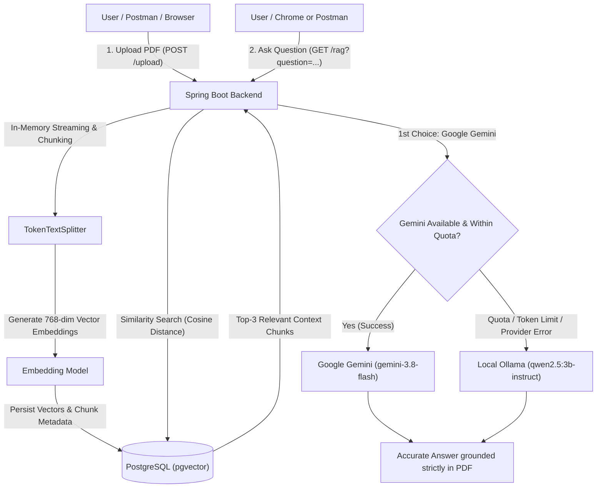
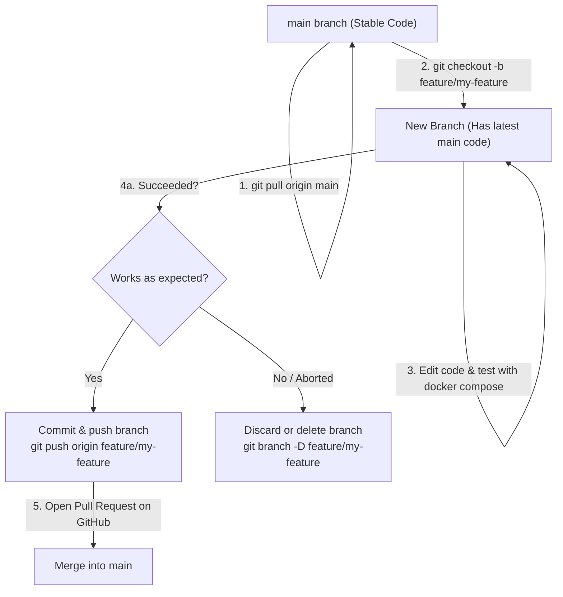

# Document RAG System (Spring Boot + Spring AI + Docker)

A resilient, production-ready **Retrieval-Augmented Generation (RAG)** backend application built with **Java 21**, **Spring Boot 4.x**, **Spring AI 2.0.x**, and **PostgreSQL with PGVector**.

The application features **Smart Dual-Model Failover**:
- 🥇 **Primary Model**: **Google Gemini (`gemini-3.8-flash`)** for fast, high-quality, cloud-powered reasoning.
- 🔄 **Automatic Shift / Fallback**: If Gemini's quota is exhausted, rate limit is hit, token limit is exceeded, or a temporary provider error occurs, the system automatically shifts to local **Qwen (`qwen2.5:3b-instruct` via Ollama)** without crashing, losing state, or dropping user requests!
- 🛡️ **Resilient Configuration**: Proper option isolation ensures Gemini receives its native `GoogleGenAiChatOptions` while Ollama receives valid `OllamaChatOptions` with the model name explicitly set, preventing casting and null-model errors.

---

## ⚡ 1-Command Quick Start (Docker Desktop)

Anyone can run this entire project (database + AI backend) with **one single command** using Docker Desktop:

```bash
docker compose up --build -d
```

*(No Java, Maven, or PostgreSQL installation required on your host machine!)*

---

## 🏗️ Architecture & Workflow



1. **Upload Phase**: A PDF is uploaded via `POST /upload`. It is streamed in-memory, chunked, converted to 768-dimensional vector embeddings, and stored in PostgreSQL with the `pgvector` extension.
2. **Query Phase**: When a question is asked via `GET /rag?question=...`, the application queries `pgvector` for the top matching document chunks and constructs a strict prompt for the LLM.
3. **Dual-Model Execution**: The application attempts **Google Gemini** first. If Gemini succeeds, the answer is returned directly. If Gemini fails due to quota limits, rate limits, token limits, or network timeouts, the system logs the event and seamlessly shifts to local **Qwen (Ollama)** to generate the answer.

---

## 📋 Prerequisites

To run this project on any computer, you only need:

1. **Docker Desktop**:
   - [Download Docker Desktop](https://www.docker.com/products/docker-desktop/) (Windows with WSL 2, macOS, or Linux).
   - Make sure Docker Desktop is running before executing commands.
2. **Git**:
   - [Download Git](https://git-scm.com/downloads).
3. **AI Provider Credentials / Models**:
   - **Google Gemini (Primary)**: Get a free API key from [Google AI Studio](https://aistudio.google.com/).
   - **Ollama (Local Fallback)**:
     - Install [Ollama](https://ollama.com/).
     - Pull the required models:
       ```bash
       ollama pull qwen2.5:3b-instruct
       ollama pull nomic-embed-text
       ```

---

## 🚀 Execution Guide

### Step 1: Clone the Repository
```bash
git clone https://github.com/Chandrasekhar-maker/RAG_System.git
cd RAG_System/document-rag/document-rag
```

*(Note: Depending on whether you cloned the root repository or entered the subfolder, navigate to the folder containing `docker-compose.yml`, `Dockerfile`, and `pom.xml`).*

---

### Step 2: Configure Environment Variables (`.env`)

Create your `.env` file from the provided `.env.example`:

```powershell
# Windows PowerShell
Copy-Item .env.example .env

# macOS / Linux / Git Bash
cp .env.example .env
```

Open `.env` in any text editor and fill in your values:

```env
# Database password
DB_PASSWORD=mysecretpassword

# Primary AI Model: Google Gemini API key
GEMINI_API_KEY=AIzaSy...your_actual_gemini_key
GEMINI_CHAT_MODEL=gemini-3.8-flash

# Fallback AI Model: Local Ollama (Qwen)
OLLAMA_BASE_URL=http://host.docker.internal:11434
OLLAMA_CHAT_MODEL=qwen2.5:3b-instruct
OLLAMA_EMBEDDING_MODEL=nomic-embed-text
```

> [!NOTE]
> `http://host.docker.internal:11434` allows the Docker container to access the Ollama server running on your host machine.

---

### Step 3: Run with Docker Compose (Recommended)

Start both PostgreSQL (with pgvector) and the Spring Boot application:

```bash
docker compose up --build -d
```

Verify that both containers are running healthy:
```bash
docker compose ps
```

Check application logs in real time:
```bash
docker compose logs -f app
```
*(Press `Ctrl + C` to exit log viewing; the containers remain running).*

---

### Step 3 (Alternative): Run Using Standalone Dockerfile

If you want to build and run the Spring Boot application container directly using the `Dockerfile`:

1. **Start PostgreSQL with PGVector**:
   ```bash
   docker run -d \
     --name rag-postgres \
     -e POSTGRES_DB=postgres \
     -e POSTGRES_USER=postgres \
     -e POSTGRES_PASSWORD=mysecretpassword \
     -p 5432:5432 \
     pgvector/pgvector:pg16
   ```

2. **Build the Docker image**:
   ```bash
   docker build -t document-rag-app .
   ```

3. **Run the application container**:
   ```bash
   docker run -d \
     --name rag-app \
     -p 8080:8080 \
     --add-host host.docker.internal:host-gateway \
     -e SPRING_DATASOURCE_URL=jdbc:postgresql://host.docker.internal:5432/postgres \
     -e SPRING_DATASOURCE_USERNAME=postgres \
     -e SPRING_DATASOURCE_PASSWORD=mysecretpassword \
     -e GEMINI_API_KEY=your_actual_gemini_key \
     -e GEMINI_CHAT_MODEL=gemini-3.8-flash \
     -e OLLAMA_BASE_URL=http://host.docker.internal:11434 \
     -e OLLAMA_CHAT_MODEL=qwen2.5:3b-instruct \
     document-rag-app
   ```

---

### Step 3 (Alternative): Run Locally with Maven Wrapper

If you have Java 21 installed and wish to run without containerizing the Java app:

1. Start PostgreSQL (e.g. via Docker: `docker run -d -p 5432:5432 -e POSTGRES_PASSWORD=postgres pgvector/pgvector:pg16`).
2. Run the application:
   ```bash
   # Windows PowerShell
   $env:DB_PASSWORD="postgres"; .\mvnw.cmd spring-boot:run

   # Linux / macOS
   DB_PASSWORD=postgres ./mvnw spring-boot:run
   ```

---

## 📮 Using the Application

### 1. Import Postman Collection (1-Click)
A ready-to-use Postman collection is included: `RAG_System.postman_collection.json`.

1. Open **Postman**.
2. Click **Import** (top left).
3. Select or drag & drop **`RAG_System.postman_collection.json`**.
4. Both requests (`1. Upload PDF` and `2. Ask Question (RAG)`) are immediately available.

---

### 2. Upload a PDF Document

#### Option A: Postman
1. Select the **`1. Upload PDF`** request (`POST http://localhost:8080/upload`).
2. Under the **Body** tab, choose **form-data**.
3. For key `file`, set type to **File**, and select any PDF document.
4. Click **Send**.
5. Response:
   ```text
   Successfully uploaded and stored 4 chunks from sample.pdf
   ```

#### Option B: cURL
```bash
curl -X POST http://localhost:8080/upload \
  -F "file=@/path/to/your/document.pdf"
```

---

### 3. Ask Questions (RAG Query)

#### Option A: Web Browser (Chrome / Edge / Firefox)
Type your question directly into your browser address bar:
```text
http://localhost:8080/rag?question=What are the main findings in the document?
```
The grounded answer is displayed directly on screen.

#### Option B: Postman
1. Select **`2. Ask Question (RAG)`** (`GET http://localhost:8080/rag`).
2. In the **Params** tab, enter your query in the `question` value field.
3. Click **Send** to view the response.

#### Option C: cURL
```bash
curl "http://localhost:8080/rag?question=What+are+the+main+findings?"
```

---

## 🌿 Git Branching Workflow (Collaboration Guide)

When collaborating on new features or improvements, follow this clean branching workflow:



1. **Pull Latest Main**:
   ```bash
   git checkout main
   git pull origin main
   ```
2. **Create a Feature Branch**:
   ```bash
   git checkout -b feature/my-new-feature
   ```
3. **Make and Test Changes**:
   ```bash
   docker compose up --build -d
   ```
4. **Commit and Push**:
   ```bash
   git add .
   git commit -m "feat: describe your change"
   git push origin feature/my-new-feature
   ```
5. **Open Pull Request on GitHub** $\rightarrow$ Merge into `main`.

---

## 🛠️ Management & Troubleshooting Commands

| Task | Command |
|---|---|
| **Start everything (in background)** | `docker compose up --build -d` |
| **Check container health & status** | `docker compose ps` |
| **Stream application logs** | `docker compose logs -f app` |
| **Stream PostgreSQL logs** | `docker compose logs -f postgres` |
| **Stop all containers** | `docker compose down` |
| **Stop and wipe vector database data** | `docker compose down -v` |
| **Rebuild after code edits** | `docker compose up --build -d` |
| **Run unit tests locally** | `.\mvnw.cmd test` *(or `./mvnw test` on Linux/macOS)* |

---

## 💾 Data Persistence

- Document vectors and chunk metadata are persisted in the Docker named volume `postgres_data`.
- Running `docker compose down` will **never lose your uploaded documents**. Your embeddings remain intact and ready when you start the containers again.
