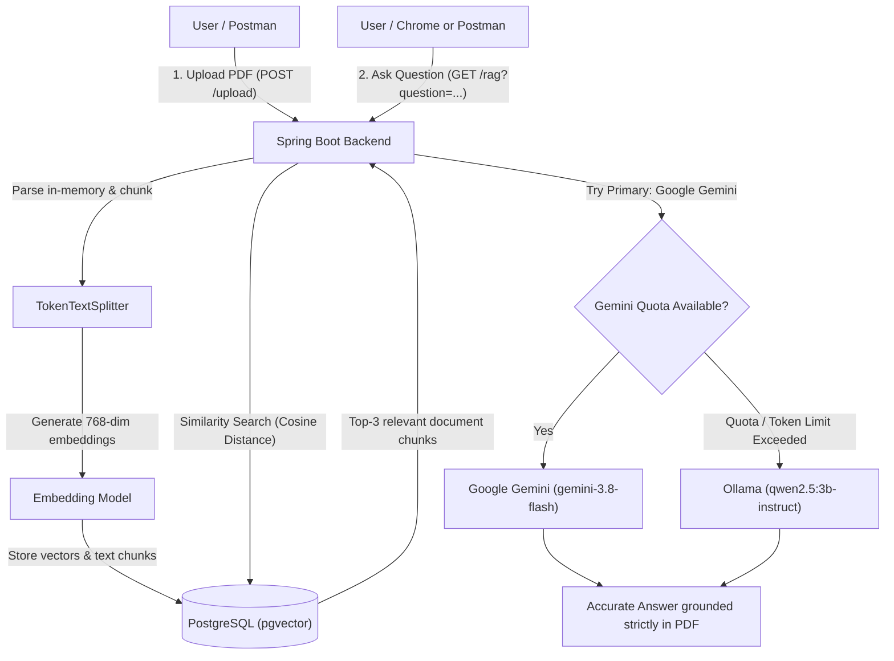
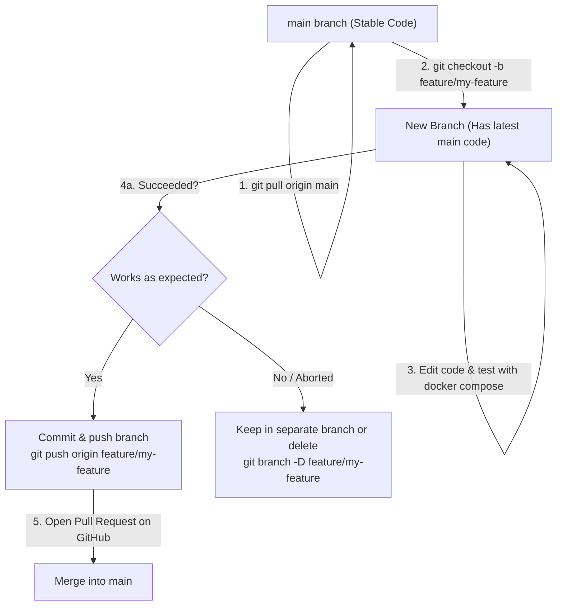

# Document RAG System (Spring Boot + Spring AI + Docker)

A resilient, production-ready **Retrieval-Augmented Generation (RAG)** application built with **Java 21**, **Spring Boot 4.x**, **Spring AI 2.0.x**, and **PostgreSQL with PGvector**.

The application features **Smart Dual-Model Failover**:
- 🥇 **Primary Preference**: **Google Gemini (`gemini-3.8-flash`)** for fast, high-quality answers.
- 🔄 **Automatic Shift / Fallback**: If Gemini's token limit, rate limit, or quota is completed, the system automatically shifts to local **Qwen (`qwen2.5:3b-instruct` via Ollama)** without crashing or dropping user requests!

---

## ⚡ 1-Command Quick Start

Anyone with permission can start the entire project (database + AI backend) with **one single command**:

```bash
docker compose up --build -d
```

*(No Java, Maven, or PostgreSQL installation required on your computer!)*

---

## 🏗️ How the Project Works



1. **Upload Phase**: A PDF is uploaded via `POST /upload`. It is streamed in-memory, chunked, converted to 768-dimensional vector embeddings, and stored in PostgreSQL with the `pgvector` extension.
2. **Query Phase**: When a question is asked via `GET /rag?question=...`, the application queries `pgvector` for the top matching document chunks and constructs a strict prompt for the LLM.
3. **Resilient AI Execution**: The app queries **Google Gemini** first. If Gemini's token limit is reached or quota is exhausted, the app catches the condition and seamlessly shifts to local **Qwen (Ollama)** to generate the answer.

---

## 📋 Prerequisites (What You Need to Install)

On a fresh computer, you only need:

1. **Docker Desktop** (with WSL 2 enabled on Windows): [Download Docker Desktop](https://www.docker.com/products/docker-desktop/)
2. **Git**: [Download Git](https://git-scm.com/downloads)
3. **AI Credentials / Models**:
   - **Google Gemini (Primary)**: Get a free API key from [Google AI Studio](https://aistudio.google.com/).
   - **Ollama (Fallback)**: Download [Ollama](https://ollama.com/) and pull the models:
     ```bash
     ollama pull qwen2.5:3b-instruct
     ollama pull nomic-embed-text
     ```

*(You do **NOT** need to install PostgreSQL, Java, or Maven. Docker packages everything!)*

---

## 🚀 Setup Steps

### Step 1: Clone the Repository
```bash
git clone https://github.com/Chandrasekhar-maker/RAG_System.git
cd RAG_System
```

### Step 2: Configure Environment (`.env`)
Create your `.env` configuration file from the template:
```powershell
# Windows PowerShell
Copy-Item .env.example .env

# macOS / Linux
cp .env.example .env
```

Open `.env` in any text editor and fill in your values:
```env
# Database password
DB_PASSWORD=mysecretpassword

# Primary AI Model: Google Gemini API key
GEMINI_API_KEY=AIzaSy...your_actual_gemini_key
GEMINI_CHAT_MODEL=gemini-3.8-flash

# Fallback AI Model: Local Ollama (Qwen)
OLLAMA_BASE_URL=http://host.docker.internal:11434
OLLAMA_CHAT_MODEL=qwen2.5:3b-instruct
OLLAMA_EMBEDDING_MODEL=nomic-embed-text
```

### Step 3: Run the Application
```bash
docker compose up --build -d
```
Check application startup logs:
```bash
docker compose logs -f app
```
*(Press `Ctrl + C` to exit log viewing).*

---

## 📮 Using the Application (Visual UI - No Terminal Inputs!)

### 1. Import Postman Collection (1-Click)
In the project folder, we included `RAG_System.postman_collection.json`.
1. Open **Postman**.
2. Click **Import** (top-left).
3. Select or drag & drop **`RAG_System.postman_collection.json`**.
4. Both requests will appear in your Postman sidebar ready to use!

---

### 2. Upload a PDF Document (Postman)
1. Open the **`1. Upload PDF`** request in Postman (`POST http://localhost:8080/upload`).
2. Go to the **Body** tab $\rightarrow$ select **form-data**.
3. Hover over the **`file`** row and ensure the type is **File**.
4. Click **Select Files** and choose any PDF from your computer.
5. Click **Send**.
6. **Response**: `Successfully uploaded and stored <N> chunks from your_document.pdf`.

---

### 3. Ask Questions

#### Option A: In Your Web Browser (Chrome / Edge)
Simply type your question in the browser address bar:
```text
http://localhost:8080/rag?question=What are the main insights in the uploaded document?
```
The AI answer renders directly on the screen!

#### Option B: In Postman
1. Open the **`2. Ask Question (RAG)`** request (`GET http://localhost:8080/rag`).
2. In the **Params** tab, enter your question in the `question` value box.
3. Click **Send** to see the response.

---

## 🌿 Git Branching Workflow (How to Collaborate & Work on Features)

When you or a teammate want to work on a new feature or experiment with code changes, follow this standard branch workflow. This ensures that the `main` branch always stays stable.



### 1. Always Start by Updating Your `main` Branch
Before starting new work, get the latest code from GitHub:
```bash
git checkout main
git pull origin main
```

### 2. Create and Switch to a New Branch
Create a new branch for your feature. This branch will automatically contain the exact current code from `main`:
```bash
git checkout -b feature/improve-prompt
```
*(Replace `feature/improve-prompt` with a name describing your change).*

### 3. Work on Your Code
Edit Java code in `src/`, update configuration, or add new features in your code editor (VS Code, IntelliJ, etc.).

Test your changes locally using Docker:
```bash
docker compose up --build -d
```

### 4. If Your Changes Succeed (Merge into `main`):
1. **Stage and commit your changes**:
   ```bash
   git add .
   git commit -m "feat: added prompt improvements and fallback logging"
   ```
2. **Push your feature branch to GitHub**:
   ```bash
   git push origin feature/improve-prompt
   ```
3. **Merge on GitHub**:
   - Go to your repository on GitHub: [https://github.com/Chandrasekhar-maker/RAG_System](https://github.com/Chandrasekhar-maker/RAG_System).
   - Click **Compare & pull request** on the yellow banner.
   - Click **Create pull request** $\rightarrow$ **Merge pull request**.
4. **Update your local `main` branch**:
   ```bash
   git checkout main
   git pull origin main
   ```

### 5. If Your Changes Do NOT Succeed (Discard or Keep Separate):
If an experiment doesn't work out:
- You can simply leave the branch as-is on your machine without affecting `main`.
- Or switch back to `main` and delete the experimental branch:
  ```bash
  git checkout main
  git branch -D feature/improve-prompt
  ```
The `main` branch remains 100% clean, working, and untouched!

---

## 🛠️ Handy Management Commands

| Action | Command |
|---|---|
| **Start everything** | `docker compose up --build -d` |
| **View application logs** | `docker compose logs -f app` |
| **View database logs** | `docker compose logs -f postgres` |
| **Stop containers** | `docker compose down` |
| **Stop and wipe database data** | `docker compose down -v` |
| **Rebuild after code edits** | `docker compose up --build -d` |

---

## 💾 Data Persistence & Backup

- **PDF Documents**: Streamed in memory and converted into vector embeddings.
- **Vectors & Text Chunks**: Persisted safely in the PostgreSQL database volume (`postgres_data`).
- Stopping the containers with `docker compose down` will **never lose your uploaded documents**. Your indexed data will still be there when you start the system again!
