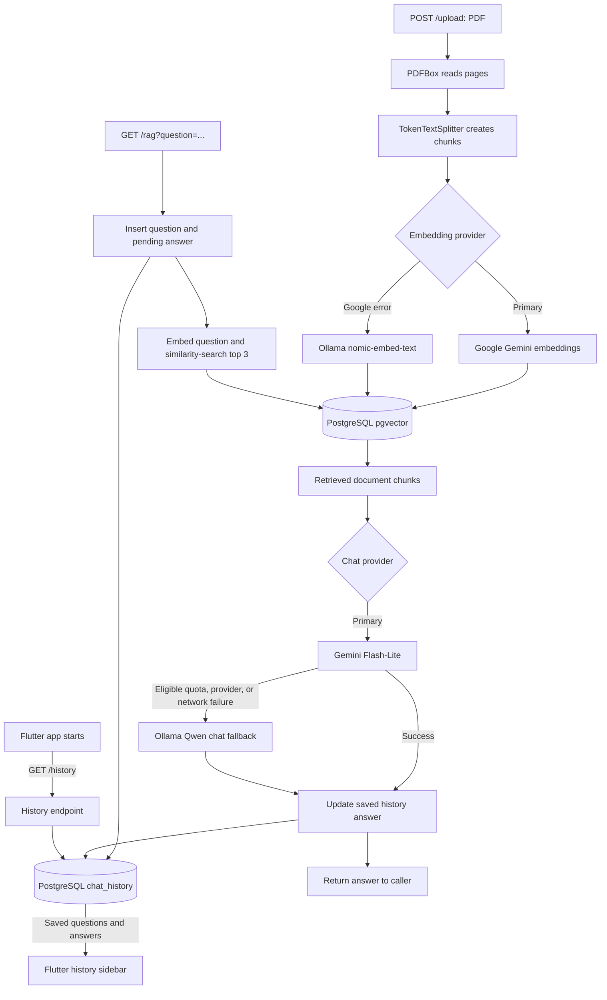

# Document RAG Backend

This folder contains the Java API for the Document RAG Assistant. It accepts PDF uploads, stores document chunks and embeddings in PostgreSQL with pgvector, retrieves relevant chunks for a question, and asks a configured language model to answer from that context.

## What is RAG?

Retrieval-Augmented Generation (RAG) combines document search with a language model. Rather than asking the model to answer from its general training alone, this application:

1. Reads pages from an uploaded PDF.
2. Splits the extracted text into smaller chunks.
3. Converts chunks to embedding vectors and stores them with their metadata.
4. Embeds a question and retrieves the three most similar chunks from pgvector using cosine distance.
5. Sends the question and retrieved context to the chat model with instructions to answer from that context.

The retrieved context grounds the answer, but this does not guarantee that a model will always be correct. Use representative documents and questions when evaluating results.

## Backend execution flow



The embedding and chat provider selectors are separate. Gemini is preferred when configured; Ollama is the fallback when the corresponding provider call fails in a supported way. Ollama chat uses Qwen (`qwen2.5:3b-instruct`), not a Llama model. The backend records a question before generation and updates its answer afterward, so it can still show a failure message in history if generation fails. The history table and vector table share the PostgreSQL database and persist through container restarts while the named volume is kept.

## Backend stack

- Java 21
- Spring Boot 4.1.1 and Spring AI 2.0.1
- Spring MVC REST endpoints
- Apache PDFBox through Spring AI's PDF document reader
- Spring AI `TokenTextSplitter` for document chunking
- PostgreSQL 16 with the pgvector extension for vector storage and similarity search
- Google Gemini Flash-Lite (`gemini-3.5-flash-lite`) as the preferred chat model, and Gemini embedding for vectors
- Ollama as fallback, configured with Qwen 2.5 3B Instruct for chat and `nomic-embed-text` for embeddings
- Docker Compose for the API and database; Maven builds the backend image in the Dockerfile's build stage

The Google embedding wrapper requests 768-dimensional vectors to match the pgvector schema. The custom embedding selector tries Gemini and falls back to Ollama on embedding errors. Chat uses Gemini first when configured, then tries Ollama on eligible provider/quota/network errors. Chat and embedding provider selection are implemented separately.

## Tokenization and chunking

`pdfUpload` uses Spring AI's `TokenTextSplitter` to break extracted PDF text into manageable chunks before embedding. This is application-side chunking; this project does not load or call a Llama tokenizer directly. The splitter is not switched based on whether Gemini or Ollama is selected.

After chunking, the chosen embedding provider converts each chunk into a vector. During question answering, the provider embeds the search query; pgvector searches for the nearest stored vectors. The chat model provider then processes the retrieved text. Gemini and Ollama/Qwen handle their own model tokenization internally when they process embeddings or chat prompts. In this project, the Ollama chat model is Qwen, not a Llama model.

## API endpoints

| Method | Endpoint | Purpose |
|---|---|---|
| `POST` | `/upload` | Accept a multipart PDF in the `file` field, parse it, split it, embed it, and store the chunks. |
| `GET` | `/rag?question=...` | Retrieve up to three relevant chunks and return a generated answer. |
| `GET` | `/history` | Return saved questions and answers, newest first. |

Upload example:

```bash
curl -X POST http://localhost:8080/upload \
  -F "file=@/path/to/document.pdf"
```

Question example:

```text
http://localhost:8080/rag?question=What%20does%20the%20document%20say%3F
```

The `/rag` controller currently waits for the complete model response before returning it; it does not stream answer tokens to the client.

Every `/rag` question is saved to the PostgreSQL `chat_history` table before generation begins, then its answer (or a failure message) is saved when processing finishes. The table is created automatically on backend startup. Records survive app/container restarts as long as the Compose database volume is kept. Questions asked before this feature was installed cannot be reconstructed; existing uploaded-document vectors remain in their current database volume.

## Configuration and running

For running the whole project on a local computer, follow the root [project README](../../README.md). The recommended Compose file is at the repository root and builds this backend with `Dockerfile`.

This directory also contains a standalone `docker-compose.yml`. If using that file, first place a `.env` file here (copy `.env.example` and set the values), then run:

```bash
docker compose up --build -d
docker compose ps
docker compose logs -f app
```

The API is published on port 8080 and PostgreSQL on port 5432. Do not run the root Compose stack and this nested stack at the same time: they publish the same ports and declare the same explicit container names.

Important environment values:

- `DB_PASSWORD` — PostgreSQL password.
- `GEMINI_API_KEY` — Gemini key; without it, chat uses Ollama if reachable.
- `GEMINI_CHAT_MODEL` — Gemini chat model name.
- `GEMINI_MAX_OUTPUT_TOKENS` — output limit for Gemini; defaults to 512 tokens to keep answers focused.
- `OLLAMA_BASE_URL` — defaults to `http://host.docker.internal:11434` for Ollama running on the host.
- `OLLAMA_CHAT_MODEL` — defaults to `qwen2.5:3b-instruct`.
- `OLLAMA_EMBEDDING_MODEL` — defaults to `nomic-embed-text`.
- `APP_RAG_REFINER_ENABLED` — defaults to `false` to avoid an extra sequential LLM call. Set to `true` to enable answer polishing.
- `OLLAMA_NUM_PREDICT` — maximum Ollama generated tokens; defaults to 512.
- `SPRING_AI_RETRY_MAX_ATTEMPTS` — defaults to 2; short backoff defaults help provider failures reach the fallback quickly instead of waiting through long retry delays.

For local Ollama fallback, install Ollama and fetch the models on the host:

```bash
ollama pull qwen2.5:3b-instruct
ollama pull nomic-embed-text
```

Do not commit `.env` files or expose API keys.

## Backend source map

| File | Responsibility |
|---|---|
| `src/main/java/com/rag/document_rag/DocumentRagApplication.java` | Spring Boot application entry point and component scanning root. |
| `src/main/java/com/rag/document_rag/controller/pdfUpload.java` | Handles `POST /upload`, PDF parsing, chunk splitting, and vector-store insertion. |
| `src/main/java/com/rag/document_rag/controller/Ragcontroller.java` | Handles `GET /rag`, similarity search, prompt construction, and answer return. |
| `src/main/java/com/rag/document_rag/history/ChatHistoryRepository.java` | Creates the history table and stores/loads questions and answers in PostgreSQL. |
| `src/main/java/com/rag/document_rag/history/ChatHistoryEntry.java` | API data record for a saved question, answer, ID, and timestamp. |
| `src/main/java/com/rag/document_rag/config/ConditionalChatClientConfig.java` | Builds the Gemini-first/Ollama-fallback chat client and optional answer refiner. |
| `src/main/java/com/rag/document_rag/config/CorsConfig.java` | Configures cross-origin requests for the Flutter web client. |
| `src/main/java/com/rag/document_rag/embedding/ConditionalEmbeddingModel.java` | Selects Gemini embeddings and falls back to Ollama if embedding fails. |
| `src/main/java/com/rag/document_rag/embedding/GoogleGenAiEmbeddingModel.java` | Calls Google's GenAI embedding API and requests the configured 768 dimensions. |
| `src/main/resources/application.properties` | Default AI, datasource, vector-store, and answer-refiner settings. |
| `pom.xml` | Java dependencies and Maven build configuration. |
| `Dockerfile` | Builds the jar in a Maven/Java 21 image and runs it in a Java 21 runtime image. |
| `docker-compose.yml` | Standalone PostgreSQL and backend services for this folder. |
| `src/test/java/com/rag/document_rag/config/ConditionalChatClientConfigTest.java` | Unit tests for model choice, fallback, and response refinement. |
| `src/test/java/com/rag/document_rag/DocumentRagApplicationTests.java` | Spring application context test. |

## Tests and operations

Run backend tests with Java 21 available on the host:

```powershell
.\mvnw.cmd test
```

On macOS/Linux:

```bash
./mvnw test
```

Useful Compose commands (run in this directory if using this folder's stack):

```bash
docker compose ps
docker compose logs -f app
docker compose logs -f postgres
docker compose stop       # Stop, keep containers and data
docker compose start      # Restart stopped containers
docker compose down       # Remove containers/network, keep named database volume
docker compose down -v    # Also delete PostgreSQL data and uploaded vectors
```
