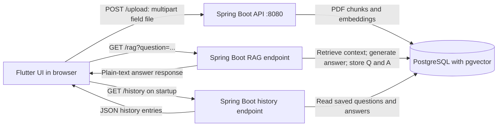

# Flutter Frontend

## Frontend stack and model placement

- Flutter and Dart to build the web UI
- Flutter Material 3 widgets for the document upload and question/answer screens
- `file_picker` to select a PDF
- `http` and `http_parser` to send the PDF as multipart form data and send questions over HTTP
- A Spring Boot backend at `http://localhost:8080`, using `POST /upload`, `GET /rag?question=...`, and `GET /history`
- A left-side question history (a navigation drawer on narrow screens), loaded from PostgreSQL when the app starts; selecting a saved question shows its saved answer

The API URL is currently hard-coded in `lib/main.dart`. The frontend is not part of Docker Compose; it runs on the developer's computer with Flutter.

The Flutter client does not load or call AI models directly. The backend selects Gemini Flash-Lite for chat and falls back to Ollama/Qwen when an eligible model-provider error occurs. PDF embeddings are also generated by the backend. Flutter's `ChatHistoryEntry` Dart model parses saved history records returned by the API.

## HTTP request flow



### Requests the UI sends

| User action | HTTP request | What happens |
|---|---|---|
| Upload a PDF | `POST /upload` as `multipart/form-data`, field name `file` | Backend parses the PDF, splits text, embeds chunks, and saves vectors. |
| Ask a question | `GET /rag?question=<encoded text>` | Backend retrieves relevant chunks, calls the configured chat model, saves the question and answer, and returns answer text. |
| Open history | `GET /history` | Backend returns saved question, answer, ID, and timestamp records as JSON. |

`http` makes the requests; `http_parser` labels the uploaded file as `application/pdf`. Cross-origin requests are enabled by the backend CORS configuration for Flutter web.

Run the client locally after starting the backend and database with Docker:

```powershell
cd rag_frontend
flutter pub get
flutter run -d web-server --web-port 8081
```

Open `http://localhost:8081`. The history appears in the sidebar after the backend returns it; new questions are persisted in the database and remain available after restarting containers as long as the PostgreSQL volume is kept.

## Remaining issue

There are no known Flutter analyzer or widget-test failures after replacing the stale starter counter test. Answers can still take a long time because the UI waits for the backend's complete AI-generated response before displaying it. This delay is in model generation, rather than Flutter rendering. The backend's optional second answer-polishing call is now disabled by default to reduce latency, but provider response time can still vary. The frontend does not currently stream partial answer text or offer a setting for a different backend URL.
